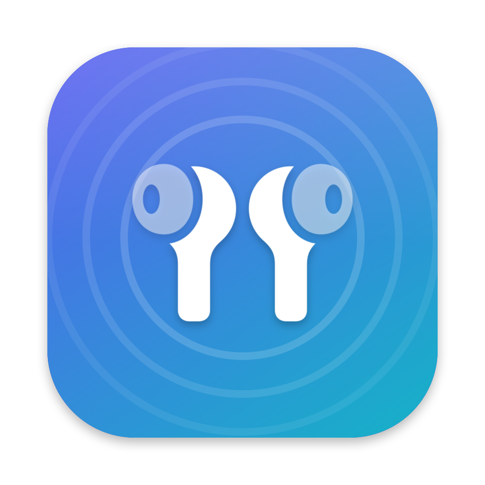

# BudsBar

A small macOS menu bar app that controls earbuds built on Airoha Bluetooth chips the way the
vendor's phone app does, without a phone: noise control (Noise Cancelling, Ambient Aware,
TalkThru), battery levels, and — on the JBL Tour Pro 3 — Spatial Sound, VoiceAware, Smart Talk,
Auto Play & Pause, automatic call answering and voice prompts.

The menu bar icon shows the earbuds plus the active mode (a crossed waveform for Noise
Cancelling, an ear for Ambient Aware, a speaking person for TalkThru), and the menu has an
**Open at Login** switch.

Not affiliated with, endorsed by or sponsored by JBL, Harman or Airoha. Product names are
trademarks of their owners and are used here only to say which devices work.

## Supported devices

| Model | What works | Status |
|---|---|---|
| JBL Tour Pro 3 | Noise control, battery (left, right, case), Spatial Sound, VoiceAware, Smart Talk, Auto Play & Pause, automatic call answering, voice prompts | Tested with this app |
| JBL Tune 770NC | Noise control | Same commands confirmed by [Hush](https://github.com/davedumto/Hush); not yet tested with this app |
| JBL Tune 670NC | Noise control | Same commands confirmed by [Hush](https://github.com/davedumto/Hush); not yet tested with this app |

The equalizer is not supported: JBL's app does not select a preset by id, it computes the filter
coefficients on the phone and writes them into the earbuds' persistent configuration, and a wrong
write there stays in the device.

Other Airoha-based earbuds expose the same transport, but each maker picks its own command
values, so a model is only enabled once it has been confirmed on real hardware. Paired devices
that expose the protocol but have no profile are shown as "not supported yet" and receive nothing.

## Requirements

- macOS 14 or later.
- The earbuds connected over Bluetooth **directly to the Mac**. The Tour Pro 3 case can also act
  as a USB audio transmitter; in that mode the Mac never talks to the earbuds and BudsBar cannot
  reach them.
- The earbuds **in your ears**: they reject mode changes while they are not worn, and the menu
  says so.

On the Tour Pro 3, the case screen only reads the mode when its page is opened: after a change from
BudsBar, or from JBL's own phone app, leave the page and come back to see it. That is the case
firmware's behaviour, not something BudsBar can trigger.

## Build and run

```bash
./scripts/build-app.sh            # builds build/BudsBar.app
./scripts/build-app.sh --install  # also copies it to ~/Applications
swift test                        # protocol tests
./scripts/make-icon.sh            # regenerates Resources/AppIcon.icns
```

The app is ad-hoc signed, not notarized. On first launch macOS may refuse to open it: right-click
the app, choose **Open**, and confirm. macOS also asks for Bluetooth access the first time.

## How it works

The earbuds advertise an RFCOMM service named `Airoha_APP` (channel 21 on the models above) that
speaks Airoha's RACE protocol:

```
05 | type | length (u16 LE, opcode + body) | opcode (u16 LE) | body
type: 5A command · 5B response · 5C notification · 5D indication
```

Noise control (all supported models):

| Command | Bytes | Reply |
|---|---|---|
| Read noise-control mode | `05 5A 04 00 01 09 05 00` | `05 5B … 01 09 05 00 00 <mode> …` |
| Set noise-control mode | `05 5A 05 00 06 0E 00 0A <mode>` | `05 5B … 06 0E <status> …` (`00` accepted, `01` rejected) |

Modes: `01` Noise Cancelling, `0A` Ambient Aware, `09` TalkThru, `00` off. After a set, the
earbuds also send an indication (`5D`, opcode `0901`) with the new mode; whether they send it for
changes made on the case or with the touch controls is not confirmed yet (use **Refresh**).
There is no known command for "off"; it is reported but not sent.

Tour Pro 3 settings, decoded from a Bluetooth capture of JBL's Android app (opcodes little-endian;
the earbud that receives a write forwards it to the other one):

| Setting | Read | Write | Values |
|---|---|---|---|
| Battery | — (pushed as `5C`, opcode `0901`) | — | body `<side> 00 00 <percent>`; side `65` left, `66` right, `67` case |
| Generic config | `2C83 <id u16>` → `00 <id> <value>` | `2C82 <id u16> <value>` → `00 <id>` | id `0002` Auto Play & Pause (`01`/`00`), `0007` VoiceAware (`01`/`00`), `0006` VoiceAware level (u16, 1–3), `0009` voice prompts (`00` on, `FF` off) |
| Spatial Sound | `0093 AA 06 03 00 01 00 2E` | `0093 AA 06 06 00 00 00 2E 02 <v1 v2>` | `00 FF` off, `01 01` fixed, `01 02` head tracking; replies `00 AA 06 06 00 02 00 2E 02 <v1 v2>` |
| Smart Talk | `0060` → `00 <on> <seconds>` | `0061 <on> <seconds>` → `00` | seconds `05`, `0F`, `14` |
| Answer calls automatically | `0087` → `00 <on>` | `0088 <on>` → `00 <on>` | `01`/`00` |

Opcode `0093` tunnels JBL's own command set (frames starting with `AA`) inside RACE.

All captured frames are pinned in `Tests/RaceKitTests`.

## Safety

On unpatched Airoha firmware, RACE also offers unauthenticated memory and flash access, firmware
update and factory reset. None of that is representable in this code: `RaceCommand` only has the
read and set cases above, with range-checked values, so the app cannot send anything else.

## Adding a model

1. Pair the earbuds with the Mac and check that they expose `Airoha_APP`.
2. Confirm on the hardware that the read and set frames above behave the same way.
3. Add a `DeviceProfile` in `Sources/RaceKit/DeviceProfile.swift` and pin any new captures in the tests.

If the commands differ, capture the official app's traffic. On Android: enable **Bluetooth HCI
snoop log** (full, not filtered) in Developer options, toggle Bluetooth, change one setting at a
time in the app, then run `adb bugreport` and take `btsnoop_hci.log` from the zip
(`FS/data/log/bt/` on Samsung, `FS/data/misc/bluetooth/logs/` elsewhere). Open it in Wireshark and
follow RFCOMM channel 21. The bug report holds a lot of personal data; keep only the snoop log.

## Credits

- [Hush](https://github.com/davedumto/Hush) and a [gist by wielkiborsuk](https://gist.github.com/wielkiborsuk/f46f6792ce9bba167a0736a2cc5ad6ae)
  documented the noise-control commands on the Tune 770NC.
- [ERNW's research](https://insinuator.net/2025/12/bluetooth-headphone-jacking-full-disclosure-of-airoha-race-vulnerabilities/)
  documented the RACE framing and its risks.

## License

MIT
